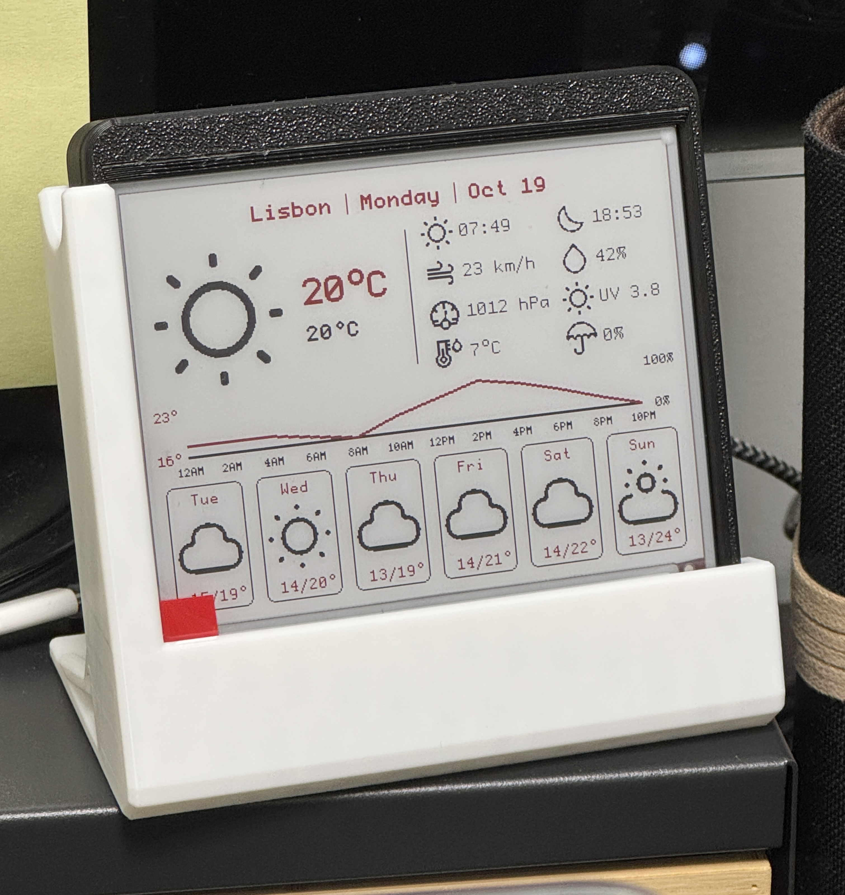

# Weatherboard

A desktop weather display, powered by an STM32WBA65 board.

Shows the current weather, daily and hourly forecasts, and the time of the last update.
A Raspberry Pi 5 hub fetches weather data from [OpenWeatherMap](https://openweathermap.org/) and sends it to the board via BLE.

The weather info layout is inspired by (i.e. ripped from) [InkyPi](https://github.com/fatihak/InkyPi).

## Project Layout

| Directory   | Description                                                                         |
| ----------- | ----------------------------------------------------------------------------------- |
| `firmware/` | Embassy firmware for the STM32WBA65 (BLE, EPD driver, etc).                         |
| `hub/`      | Rust BLE central that pushes weather to the board.                                  |
| `server/`   | Weather fetching and web interface (TODO).                                          |
| `common/`   | Types shared by the firmware and the host crates.                                   |
| `ui/`       | Display layout, shared with the simulator.                                          |
| `sim/`      | Desktop simulator for the UI (SDL2).                                                |
| `hardware/` | Board and display reference files.                                                  |
| `fusion/`   | Enclosure Fusion/CAD files for the display plate, and the little support structure. |

## TODOs

- [x] Weather fetching
- [x] Weather display
- [x] Hub <—> Board communication
- [ ] ESP32 bridge (because the comms are incredibly unstable between the hub and the board, since I want them in opposite walls of adjacent rooms)
- [ ] Web interface (config, etc)
- [ ] Maybe traffic information summary?
